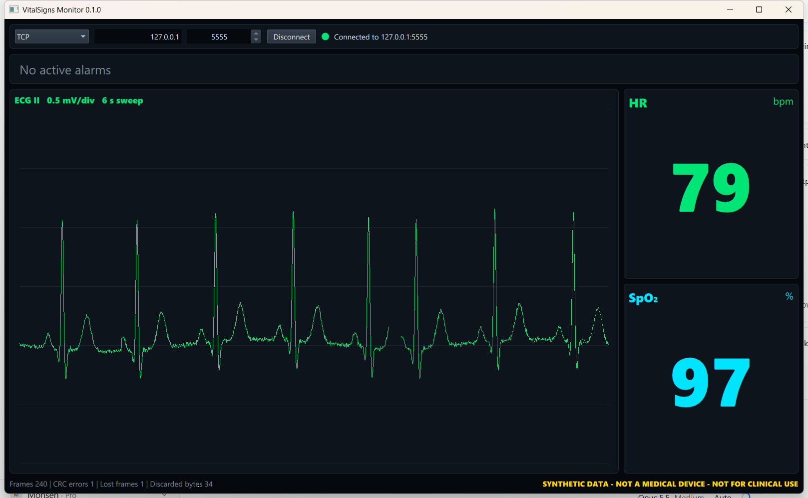
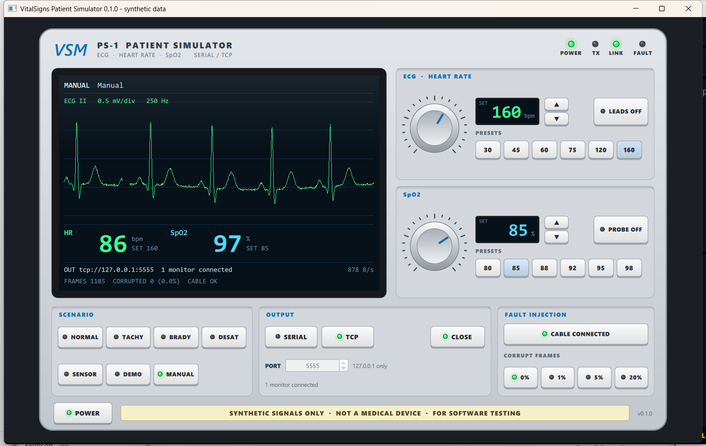
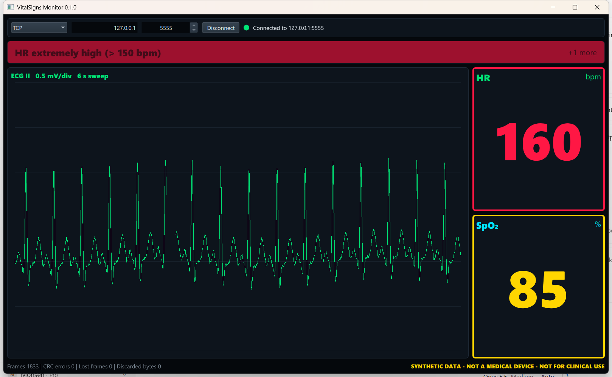

# VitalSigns Monitor

A desktop vital-signs monitor written in **C++20** and **Qt 6 / QML**. It receives data from a
simulated bedside device over **TCP or a serial port**, draws a live ECG sweep, shows heart rate and
SpO2, and raises prioritised **alarms**.



> **Synthetic data only. This is not a medical device.**
> All signals come from the included simulator, which generates a synthetic ECG and synthetic
> numbers. No real patient data is used, stored or transmitted. The project is a learning and
> portfolio project and must not be used for diagnosis or patient monitoring.

## Features (v0.1)

- **Patient simulator with a hardware-style front panel** (`VitalSignsPatientSimulator`): colour
  LCD with the generated ECG, knobs and keys for heart rate and SpO2, "leads off" / "probe off"
  keys, scenario keys, serial-port or TCP output, and fault injection (unplugged cable, corrupted
  frames). Status LEDs for power, TX, link and fault.
- **Console simulator** (`VitalSignsSimulator`) with the same engine, for scripts.
- **Synthetic patient model**: ECG built from Gaussian P-QRS-T waves, heart rate and SpO2 that
  change gradually, scripted scenarios (tachycardia, bradycardia, desaturation, sensor off).
- **Binary protocol** with sync bytes, sequence numbers and CRC-16, plus a streaming decoder that
  re-synchronises after corrupted data ([docs/PROTOCOL.md](docs/PROTOCOL.md)).
- **Separate I/O thread**: socket/serial handling and parsing never block the UI.
- **Automatic reconnect** and a **watchdog** that raises "No data from device" after 3 s.
- **Alarm engine**: high/medium/low priorities, one alarm per parameter, technical alarms for
  leads off, probe off and lost link. Rules are pluggable (Strategy pattern).
- **Qt Quick UI**: ECG sweep drawn with the Qt Quick scene graph, numeric tiles, alarm banner, link
  statistics (frames, CRC errors, lost frames).
- **63 unit tests** with GoogleTest (protocol, decoder, alarms, buffers, device session with a
  fake transport, simulator engine with a fake clock).



## Architecture

```
 VitalSignsPatientSimulator
 (or VitalSignsSimulator)  --TCP / serial-->  VitalSignsMonitor
                                        +----------------------------------------+
                                        | app      QML UI, MonitorViewModel      |  GUI thread
                                        +----------------------------------------+
                                        | device   DeviceController -> I/O thread|
                                        |          DeviceSession, ITransport     |
                                        +-------------------+--------------------+
                                        | core              | protocol           |  pure C++20
                                        | alarms, vitals    | frames, CRC, codec |  (no Qt)
                                        +-------------------+--------------------+
```

Details, design decisions and the SOLID mapping: [docs/ARCHITECTURE.md](docs/ARCHITECTURE.md).

## Build

Requirements: CMake 3.25+, a C++20 compiler (MSVC 2022, GCC 11+ or Clang 14+), Qt 6.8+ with the
modules **Qt Quick, Qt Quick Controls, Qt Network, Qt Serial Port**. GoogleTest is downloaded
automatically at configure time.

**Qt Creator:** open `CMakeLists.txt` and pick a Qt 6.8+ kit (MinGW or MSVC).

**Command line (Windows, MinGW, Git Bash):**

```bash
export QTDIR=C:/Qt/6.12.0/mingw_64
export PATH="$QTDIR/bin:/c/Qt/Tools/mingw1310_64/bin:/c/Qt/Tools/Ninja:$PATH"
cmake --preset mingw-debug
cmake --build --preset mingw-debug
ctest --preset mingw-debug
```

**Command line (Windows, MSVC):** set `QTDIR` to an `msvc2022_64` kit and use the presets
`windows-msvc` / `windows-debug`.

**Command line (Linux):**

```bash
export QTDIR=~/Qt/6.9.2/gcc_64
cmake --preset linux-debug
cmake --build --preset linux-debug
ctest --preset linux-debug
```

## Run

1. Start the patient simulator. It opens a TCP server on `127.0.0.1:5555` at start-up:

   ```bash
   VitalSignsPatientSimulator
   ```

   Turn the knobs (drag up/down or use the mouse wheel), press a preset, a scenario key or
   **LEADS OFF** / **PROBE OFF**. In **OUTPUT** choose **SERIAL** or **TCP** and press **OPEN**.
   **FAULT INJECTION** unplugs the virtual cable or corrupts 1/5/20 % of the frames.
   Start-up options: `--serial COM5 --baud 115200`, `--port 5555`, `--scenario demo`.

   Or use the console simulator:

   ```bash
   VitalSignsSimulator --scenario demo
   ```

   Options: `--scenario normal|tachycardia|bradycardia|desaturation|sensor-off|demo`,
   `--port 5555`, `--serial COM5 --baud 115200`, `--rate 250`, `--corrupt 0.02`.

2. Start the monitor and click **Connect**, or connect at start-up:

   ```bash
   VitalSignsMonitor --connect 127.0.0.1:5555
   ```

On Windows the Qt `bin` folder must be on `PATH` (Qt Creator does this for you), or run
`windeployqt` on the executable.

**Serial port without hardware:** create a virtual COM-port pair (e.g. com0com: `COM5 <-> COM6`).
In the patient simulator choose **SERIAL**, port `COM5`, **OPEN**; in the monitor select `COM6`.

### What to try

| Action on the simulator | Expected on the monitor |
|---|---|
| HR preset **160** | red alarm "HR extremely high (> 150 bpm)" after HR passes 150 (it rises 3 bpm/s) |
| SpO2 preset **85** | yellow SpO2 alarm (< 90 %) |
| **LEADS OFF** | HR shows `---`, flat ECG, technical alarm "ECG leads off" |
| **CABLE UNPLUGGED** | after 3 s "No data from device"; after plugging in, "Lost frames" counts the gap |
| **CORRUPT 5 %** | "CRC errors" rises, the display keeps running |



## Project layout

```
src/protocol/    wire format: Frame, FrameDecoder, Messages, CRC-16           (C++20, no Qt)
src/core/        domain: VitalSigns, AlarmEvaluator, alarm rules, SweepBuffer (C++20, no Qt)
src/device/      ITransport, TcpTransport, SerialTransport, DeviceSession, DeviceController
src/ui/          shared QML module VitalSigns.Ui: WaveformSeries, WaveformItem
src/app/         main.cpp (composition root), view models, QML
tools/simulator/engine/  vsm_simulation: SyntheticPatient, Scenario, DeviceSimulator, TCP/serial sinks
tools/simulator/cli/     VitalSignsSimulator (console)
tools/simulator/gui/     VitalSignsPatientSimulator (front panel, QML)
tests/           GoogleTest unit tests
docs/            architecture, protocol, screenshots
Documents/       RFP, developer, user and installation guides (Word, English and Persian) + sources
```

## Documents

`Documents/EN` and `Documents/FA` hold four Word documents each, in English and Persian:
Request for Proposal (requirements with IDs), Developer Guide, User Guide and Installation and
Setup Guide. They are generated from the Markdown-like sources in `Documents/source` with
`Documents/source/build-docs.ps1` (needs Microsoft Word).

## Roadmap

- [x] Week 2: CMake project, simulator, protocol, parsing in a separate thread
- [ ] Week 3: alarm manager (latching, silence, audio), audit log, more tests, GitHub Actions (Windows + Linux)
- [ ] Week 4: medical-software documentation as a learning exercise (risk table in the style of
      ISO 14971, software requirements and traceability in the style of IEC 62304), Linux build in WSL2
- [ ] Later: stream data to the CareHub web app (ASP.NET Core + SignalR)

## License

Not chosen yet. All rights reserved until a license file is added.
